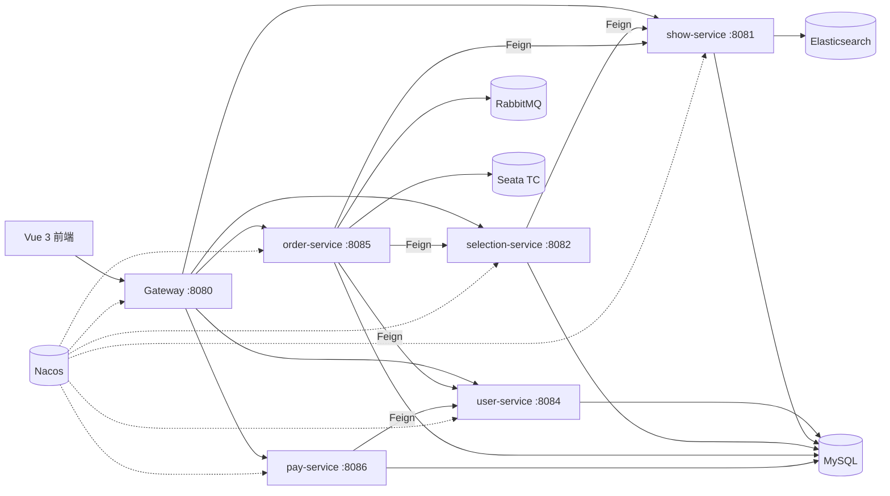

# SHOWTICKET · 演出票务平台

一个基于 Spring Cloud Alibaba 的演出票务平台。

## 项目结构

```text
showticket/
├── showticket-common/        # 公共依赖、统一异常、分页、JSON/MQ 配置
├── showticket-api/           # Feign 客户端、DTO、Feign 错误解码
├── showticket-gateway/       # 网关、JWT 鉴权、动态路由
├── user-service/             # 用户、余额、收票地址
├── show-service/             # 演出、余票、ES 搜索
├── selection-service/        # 选票清单
├── order-service/            # 订单、出票、超时关单
├── pay-service/              # 支付单、余额支付
├── web/                      # Vue 3 前端
├── nacos/                    # Nacos 配置模板
├── sql/                      # 数据库脚本
├── scripts/                  # 种子数据生成脚本
└── pom.xml
```

## 核心接口

| 方法 | 路径 | 说明 |
|---|---|---|
| POST | `/users/login` | 登录 |
| GET | `/users/me` | 当前用户与余额 |
| GET | `/shows/page` | 演出分页 |
| GET | `/shows/{id}` | 演出详情 |
| GET | `/search/list` | 演出搜索（ES/DB 降级） |
| GET | `/selections` | 我的选票清单 |
| POST | `/selections` | 加入选票清单 |
| PUT | `/selections` | 修改数量 |
| DELETE | `/selections/{id}` | 删除选票清单条目 |
| GET | `/addresses` | 收票地址 |
| POST | `/orders` | 创建订单 |
| GET | `/orders` | 我的订单分页 |
| GET | `/orders/{id}` | 订单详情（票明细 + 出票信息） |
| PUT | `/orders/{id}/cancel` | 取消未支付订单 |
| POST | `/pay-orders` | 创建支付单 |
| POST | `/pay-orders/{id}` | 余额支付 |
| POST | `/search/reindex` | 重建演出 ES 索引 |

## 模块说明

| 模块 | 端口 | 数据库 | 职责 |
|---|---:|---|---|
| `showticket-gateway` | 8080 | - | 统一入口、JWT 鉴权、Nacos 动态路由、CORS |
| `user-service` | 8084 | `ticket_user` | 登录、用户信息、余额扣减、收票地址 |
| `show-service` | 8081 | `ticket_show` | 演出管理、余票扣减/恢复、ES 搜索与索引重建 |
| `selection-service` | 8082 | `ticket_selection` | 选票清单 |
| `order-service` | 8085 | `ticket_order` | 下单、订单查询、取消、超时关单、出票信息 |
| `pay-service` | 8086 | `ticket_pay` | 支付单、余额支付、支付成功消息 |

公共模块：

- `showticket-common`：统一返回、异常、分页、JSON、MyBatis、MQ 配置。
- `showticket-api`：Feign 客户端、DTO、Feign 错误解码。
- `web`：Vue 3 前端。

## 系统架构



## 技术栈

| 层次 | 技术 |
|---|---|
| 前端 | Vue 3、Vite、Vue Router、Axios |
| 微服务 | Spring Boot 2.7、Spring Cloud、Spring Cloud Alibaba |
| 注册/配置 | Nacos |
| 服务调用 | OpenFeign、LoadBalancer |
| 网关 | Spring Cloud Gateway、动态路由 |
| 分布式事务 | Seata AT |
| 消息 | RabbitMQ、延迟消息插件 |
| 搜索 | Elasticsearch 7.12、IK 分词 |
| 持久层 | MyBatis-Plus、MySQL 8 |
| 鉴权 | JWT（RSA） |

## 功能特性

- **演出浏览与搜索**：关键词搜索、演出类型筛选、场馆筛选、价格排序、分页；Elasticsearch 优先，异常时自动降级 MySQL。
- **演出详情**：演出信息、场次时间、票档、余票、购票数量选择。
- **选票清单**：加入演出、修改数量、删除、选择收票地址。
- **下单**：Seata AT 全局事务，扣减余票、清理选票清单、写出票信息。
- **余额支付**：支付成功通过 RabbitMQ 即时通知订单服务；支付成功后才生成取票码。
- **订单中心**：我的订单、订单详情、主动取消订单、超时自动关闭并恢复余票。
- **索引管理**：一键重建 Elasticsearch 索引，将 216 条演出全量导入。
- **登录鉴权**：JWT + Spring Cloud Gateway 全局过滤器。
