# SHOWTICKET · 演出票务平台

一个基于 Spring Cloud Alibaba 微服务架构的演出票务系统，覆盖演出搜索、选票清单、下单、余额支付、自动出票、主动取消与超时关单的完整链路。

前端使用 Vue 3 + Vite，后端由 6 个微服务组成，集成 Nacos、OpenFeign、Seata AT、RabbitMQ 延迟消息与 Elasticsearch。

> 本项目用于学习与作品展示，已完整改造为演出票务领域。

## 功能特性

- **演出浏览与搜索**：关键词搜索、演出类型筛选、场馆筛选、价格排序、分页；Elasticsearch 优先，异常时自动降级 MySQL。
- **演出详情**：演出信息、场次时间、票档、余票、购票数量选择。
- **选票清单**：加入演出、修改数量、删除、选择收票地址。
- **下单**：Seata AT 全局事务，扣减余票、清理选票清单、写出票信息。
- **余额支付**：支付成功通过 RabbitMQ 即时通知订单服务；支付成功后才生成取票码。
- **订单中心**：我的订单、订单详情、主动取消订单、超时自动关闭并恢复余票。
- **索引管理**：一键重建 Elasticsearch 索引，将 216 条演出全量导入。
- **登录鉴权**：JWT + Spring Cloud Gateway 全局过滤器。

## 技术栈

| 层次 | 技术 |
|---|---|
| 前端 | Vue 3、Vite、Vue Router、Axios |
| 微服务 | Spring Boot 2.7、Spring Cloud、Spring Cloud Alibaba |
| 注册/配置 | Nacos |
| 服务调用 | OpenFeign、LoadBalancer |
| 网关 | Spring Cloud Gateway、动态路由 |
| 分布式事务 | Seata AT |
| 消息 | RabbitMQ、延迟消息插件 |
| 搜索 | Elasticsearch 7.12、IK 分词 |
| 持久层 | MyBatis-Plus、MySQL 8 |
| 鉴权 | JWT（RSA） |

## 系统架构

```mermaid
flowchart LR
    Browser[Vue 3 前端] --> Gateway[Gateway :8080]

    Gateway --> User[user-service :8084]
    Gateway --> Show[show-service :8081]
    Gateway --> Selection[selection-service :8082]
    Gateway --> Order[order-service :8085]
    Gateway --> Pay[pay-service :8086]

    User --> MySQL[(MySQL)]
    Show --> MySQL
    Show --> ES[(Elasticsearch)]
    Selection --> MySQL
    Order --> MySQL
    Pay --> MySQL

    Selection -->|Feign| Show
    Order -->|Feign| Show
    Order -->|Feign| Selection
    Order -->|Feign| User
    Pay -->|Feign| User

    Order --> RabbitMQ[(RabbitMQ)]
    Order --> Seata[(Seata TC)]

    Nacos[(Nacos)] -.-> Gateway
    Nacos -.-> User
    Nacos -.-> Show
    Nacos -.-> Selection
    Nacos -.-> Order
    Nacos -.-> Pay
```



## 模块说明

| 模块 | 端口 | 数据库 | 职责 |
|---|---:|---|---|
| `showticket-gateway` | 8080 | - | 统一入口、JWT 鉴权、Nacos 动态路由、CORS |
| `user-service` | 8084 | `ticket_user` | 登录、用户信息、余额扣减、收票地址 |
| `show-service` | 8081 | `ticket_show` | 演出管理、余票扣减/恢复、ES 搜索与索引重建 |
| `selection-service` | 8082 | `ticket_selection` | 选票清单 |
| `order-service` | 8085 | `ticket_order` | 下单、订单查询、取消、超时关单、出票信息 |
| `pay-service` | 8086 | `ticket_pay` | 支付单、余额支付、支付成功消息 |

公共模块：

- `showticket-common`：统一返回、异常、分页、JSON、MyBatis、MQ 配置。
- `showticket-api`：Feign 客户端、DTO、Feign 错误解码。
- `web`：Vue 3 前端。

## 快速开始

### 1. 环境要求

- JDK 11+（示例使用 JDK 21）
- Maven 3.8+
- Node.js 18+
- MySQL 8.0
- Nacos 2.x
- Elasticsearch 7.12.1 + IK 分词器
- RabbitMQ 3.8+（开启延迟消息插件）
- Seata 1.5.2

### 2. 初始化数据库

按顺序执行：

```bash
mysql -h <mysql-host> -u root -p < sql/01_schema.sql
mysql -h <mysql-host> -u root -p < sql/02_seed_user_address.sql
mysql -h <mysql-host> -u root -p < sql/03_seed_shows.sql
```

脚本说明：

| 文件 | 内容 |
|---|---|
| `sql/01_schema.sql` | 5 个业务库、业务表、Seata `undo_log` |
| `sql/02_seed_user_address.sql` | 测试用户、收票地址 |
| `sql/03_seed_shows.sql` | 216 条演出数据（由 `scripts/generate_seed_shows.py` 生成） |

### 3. 导入 Nacos 配置

将 `nacos/` 下的文件导入 Nacos，`group` 均为 `DEFAULT_GROUP`：

| Data ID | 类型 | 说明 |
|---|---|---|
| `shared-jdbc.yaml` | YAML | 数据源 |
| `shared-log.yaml` | YAML | 日志 |
| `shared-swagger.yaml` | YAML | Knife4j |
| `shared-seata.yaml` | YAML | Seata 注册与事务分组 |
| `gateway-routes.json` | JSON | 网关动态路由 |
| `selection-service.yaml` | YAML | 选票清单服务参数 |

请把文件中的数据库地址、账号密码、Nacos 地址替换为你的环境。

### 4. 配置 Seata

在 Seata Server 的 `conf/file.conf` 中加入：

```hocon
service {
  vgroupMapping.showticket = "default"
}
```

或使用 Nacos 配置中心时，在 `seataServer.properties` 中加入：

```properties
service.vgroupMapping.showticket=default
```

重启 Seata Server。Seata 的 RPC 端口按你的部署调整（本示例环境为 `8099`，默认为 `8091`）。

### 5. 开启 RabbitMQ 延迟插件

```bash
rabbitmq-plugins enable rabbitmq_delayed_message_exchange
```

延迟队列用于订单超时关闭，未开启时下单/状态同步会受影响。

### 6. 安装 IK 分词器

Elasticsearch 7.12.1 需要安装同版本 IK 插件，否则重建索引会失败。

### 7. 启动后端

建议启动顺序：

```text
user-service       8084
show-service       8081
selection-service  8082
pay-service        8086
order-service      8085
gateway            8080
```

`order-service` 依赖 RabbitMQ 与 Seata，建议最后启动。

使用 JDK 21 运行时，需要为每个服务添加 VM 参数：

```text
--add-opens java.base/java.lang=ALL-UNNAMED
--add-opens java.base/java.lang.invoke=ALL-UNNAMED
--add-opens java.base/java.util=ALL-UNNAMED
```

也可以在 IDEA 中为每个 Spring Boot 启动类配置对应的 VM options。

构建：

```bash
mvn clean package -DskipTests
```

### 8. 启动前端

```bash
cd web
npm install
npm run dev
```

打开 `http://localhost:5173`。

Vite 已将 `/api` 代理到 `http://127.0.0.1:8080`；如需修改网关地址，编辑 `web/vite.config.js`。

### 9. 导入 Elasticsearch 索引

服务启动后执行：

```bash
curl -X POST http://localhost:8081/search/reindex
```

或在前端「索引管理」页面点击「重建索引」。预期返回 `216`。

验证：

```bash
curl http://localhost:9200/shows/_count
```

## 测试账号

```text
用户名：tester
密码：123456
初始余额：¥10,000.00
```

## 核心接口

| 方法 | 路径 | 说明 |
|---|---|---|
| POST | `/users/login` | 登录 |
| GET | `/users/me` | 当前用户与余额 |
| GET | `/shows/page` | 演出分页 |
| GET | `/shows/{id}` | 演出详情 |
| GET | `/search/list` | 演出搜索（ES/DB 降级） |
| GET | `/selections` | 我的选票清单 |
| POST | `/selections` | 加入选票清单 |
| PUT | `/selections` | 修改数量 |
| DELETE | `/selections/{id}` | 删除选票清单条目 |
| GET | `/addresses` | 收票地址 |
| POST | `/orders` | 创建订单 |
| GET | `/orders` | 我的订单分页 |
| GET | `/orders/{id}` | 订单详情（票明细 + 出票信息） |
| PUT | `/orders/{id}/cancel` | 取消未支付订单 |
| POST | `/pay-orders` | 创建支付单 |
| POST | `/pay-orders/{id}` | 余额支付 |
| POST | `/search/reindex` | 重建演出 ES 索引 |

## 项目结构

```text
showticket/
├── showticket-common/        # 公共依赖、统一异常、分页、JSON/MQ 配置
├── showticket-api/           # Feign 客户端、DTO、Feign 错误解码
├── showticket-gateway/       # 网关、JWT 鉴权、动态路由
├── user-service/             # 用户、余额、收票地址
├── show-service/             # 演出、余票、ES 搜索
├── selection-service/        # 选票清单
├── order-service/            # 订单、出票、超时关单
├── pay-service/              # 支付单、余额支付
├── web/                      # Vue 3 前端
├── nacos/                    # Nacos 配置模板
├── sql/                      # 数据库脚本
├── scripts/                  # 种子数据生成脚本
└── pom.xml
```

## 设计要点

- **Seata AT 全局事务**：下单同时操作订单库、演出余票与选票清单，保证一致性。
- **RabbitMQ 延迟消息**：订单创建后发送延迟消息，超时未支付自动关单并恢复余票。
- **支付成功即时通知**：支付成功后通过 `payment.success` 消息通知订单服务，避免等待超时消息。
- **取票码后置生成**：支付成功后生成取票码，未支付订单不展示出票信息。
- **取消幂等**：用户主动取消与超时取消通过状态条件更新，避免重复恢复库存。
- **ES 搜索降级**：搜索优先走 Elasticsearch，异常时自动回退 MySQL。
- **Feign 错误解码**：把下游业务异常统一转换为可读提示，避免直接返回 500。
- **Nacos 动态路由**：网关路由从 Nacos `gateway-routes.json` 动态加载。

## 注意事项

- 仓库中的数据库密码、Nacos 账号、JWT keystore 密码均为演示配置，部署到公网前请替换为安全配置。
- `showticket.jks` 为演示用 JWT 密钥库，生产环境请重新生成并妥善保管。
- 完整下单流程需要 RabbitMQ、Seata 和 Elasticsearch 正常运行。
- 使用 JDK 21 运行时，务必添加 `--add-opens` VM 参数。
- `sql/01_schema.sql` 会重建表结构，请勿直接在生产库执行。

## License

本项目仅用于学习与作品展示。
